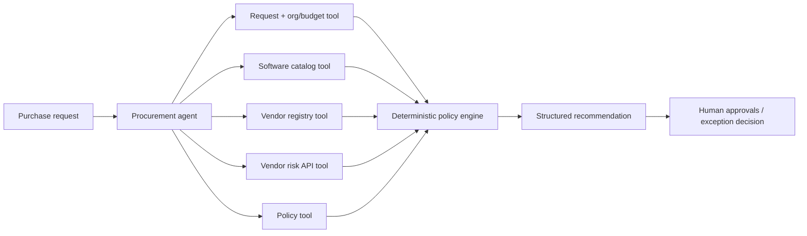

# Aegis - AI Procurement Request Copilot

A small internal copilot for software and service requests. It gathers grounded evidence, applies procurement policy deterministically, and recommends the next **human** action. It never approves spend, signs vendor terms, changes a budget, or purchases software.

The project is intentionally designed as a reliable AI workflow: the agent coordinates tools, an optional LLM synthesizes grounded evidence, and non-negotiable policy decisions stay in readable code. This prevents an LLM from inventing approvals while still allowing a real model-backed agent comparison.

## Run locally

Requirements: Python 3.11+.

```bash
python3 -m venv .venv
source .venv/bin/activate
python3 -m pip install -r requirements.txt
python3 run_local.py
```

Open `http://127.0.0.1:8501`. The one-command launcher starts both the Streamlit product and the local vendor-risk API. No external secret or model credential is required.

To enable an LLM, copy `.env.example` to `.env`, uncomment **one** provider key plus its matching `MODEL_NAME`, then restart. OpenAI, Gemini, and Anthropic are supported through LiteLLM. Without a key, the same deterministic workflow runs in fallback mode so the app and tests remain reproducible.

```bash
cp .env.example .env
```

Choose one of the commented provider blocks in `.env`. Never commit that file.

To verify the project and evaluate both architectures:

```bash
python3 verify_setup.py
python3 evals/run_comparison.py
python3 -m unittest discover -s tests -v
```

## Product workflow



Every analysis returns the required contract: recommendation and next step, grounded evidence, approvals required, missing information, risk flags, a human-review marker, and tool telemetry. The UI is an advisory workspace rather than a purchase-flow UI.

## Tools and controls

| Tool | What it retrieves | Guardrail |
|---|---|---|
| `request_context_tool` | Purchase request | Request text is untrusted data. |
| `organization_budget_tool` | Requester and available department budget | Budget comparison is deterministic. |
| `software_catalog_tool` | Existing approved tools | Overlap is surfaced, not automatically rejected. |
| `vendor_registry_tool` | Internal onboarding, security, legal status | Conflicts are preserved as evidence. |
| `vendor_risk_api_tool` | External security/risk status | Failure means unknown, never favorable. |
| `policy_tool` | Policy version/reference date | Thresholds and expiry checks run in code. |

The policy engine uses the supplied 2026-09-30 snapshot date, enforces approval thresholds, checks budget, detects catalog overlap, dates vendor reviews, identifies sensitive data, and handles expected failure cases. The prompt-injection guard treats instruction-like request text as business data and flags it without changing rules.

## Architectures compared

### A. Single coordinator

One `ProcurementAgent` invokes the six read-only tools, sends the normalized evidence pack to the configured LLM for an advisory synthesis, and passes the facts to the deterministic policy engine. This produces one LLM call when a provider is configured.

### B. Staged review

An `EvidenceAnalyst` creates the structured, read-only evidence pack and produces an LLM evidence synthesis. A `PolicyReviewer` receives only that pack, produces an independent LLM synthesis, and applies the exact same deterministic policy engine. This produces two LLM calls when configured.

Both paths preserve human review and return `ProcurementDecision` through the stable `handle_request(request_id, architecture)` adapter used by the evaluation harness.

## Evaluation

`evals/run_comparison.py` starts the mock API if needed and runs the supplied public test set against both paths. It produces `evals/results_single.csv`, `evals/results_staged.csv`, and `evals/comparison_summary.md`.

The six cases cover low-value approvals, existing-tool overlap, source-code access, budget shortfall, sensitive/new vendors, prompt injection, incomplete information, and API failure. Results include elapsed time plus LLM and tool call counts. The checked-in summary records the latest run; local latency is informational and varies with machine/API warm-up.

## Ship decision

Ship the **single coordinator**. In the same public set, the staged path did not improve policy correctness, evidence grounding, escalation, or human controls. The single path is smaller, easier to debug, and easier to audit. See [the architecture decision memo](docs/ARCHITECTURE_DECISION.md).

## Assumptions and limitations

- The supplied synthetic data and mock API are the source of truth for this assessment.
- The product runs fully locally; production authentication, persistence, audit storage, and real contract integrations are not included.
- The optional LLM has no decision authority: it only synthesizes evidence. Thresholds, routing, and the final recommendation remain deterministic and are regression-tested.
- The external API is intentionally failure-prone. A real integration needs retries, monitoring, and a documented manual fallback.
- This is a recommendation system, not a system of record. Humans retain final authority at every sensitive gate.

## Project layout

```text
app.py                    Streamlit product UI
src/tools.py              Read-only evidence tools
src/policy_engine.py      Deterministic policy and human controls
src/solution.py           Single and staged architecture adapter
mock_api/                 Local vendor-risk service
evals/                    Public harness, comparison runner, results
tests/                    Regression and supplied integrity tests
docs/                     Brief, architecture memo, workflow notes
```

## Security

Never commit a `.env` file or credentials. `.env.example` contains only the local mock-service setting.
